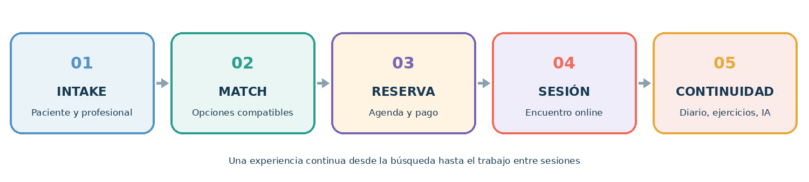
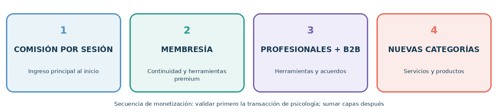
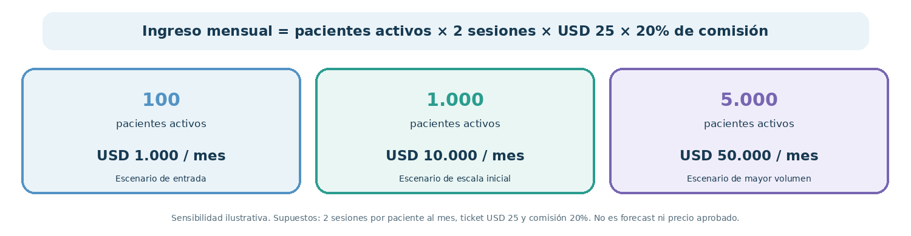
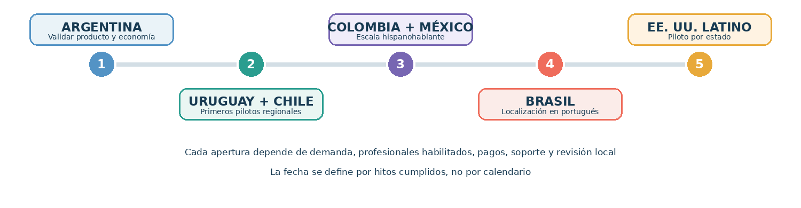

**Tesis de inversión**

Construir desde Argentina una plataforma digital de acompañamiento emocional que conecte pacientes con profesionales habilitados, facilite el matching y la continuidad entre sesiones, y luego expanda el mismo motor de confianza a otras categorías de bienestar y a mercados hispanohablantes.

Estado del proyecto: estabilización de web y aplicaciones, con transacciones piloto en Argentina. Este plan separa hechos conocidos, recomendaciones y supuestos que deben validarse antes de usarse como proyección financiera.

Versión de trabajo \| 29 de septiembre de 2026

# 1. Resumen ejecutivo

Motivar Care es una plataforma web y mobile que ayuda a las personas a encontrar un profesional adecuado, reservar y pagar sesiones online y sostener prácticas de bienestar entre encuentros. La psicología será el primer servicio. El producto combina intake del paciente y del profesional, matching, agenda, sesiones, diario emocional voluntario, ejercicios de respiración, audio relajante y un chat de IA complementario, con límites claros y derivación ante señales de crisis.

La oportunidad inicial no es lanzar muchas categorías al mismo tiempo. Es demostrar que Motivar puede adquirir pacientes a un costo sostenible, activar profesionales con disponibilidad real, generar una primera sesión satisfactoria y lograr continuidad. Una vez probada esa economía en Argentina, el plan abre mercados de forma secuencial y solo después amplía la oferta.

La OPS estima una brecha de tratamiento de trastornos mentales superior al 77,9% en América Latina y el Caribe. Es una señal de necesidad social, no un cálculo de mercado pagador para Motivar. En Estados Unidos, el Censo estimó 68 millones de residentes hispanos al 1 de julio de 2024; el segmento latino de EE. UU. es una etapa potencial grande, pero regulatoriamente distinta porque la práctica se controla por estado y ubicación del paciente. \[1\]\[2\]\[3\]

| **Elemento**        | **Definición de trabajo**                                                                                                                                                               |
|---------------------|-----------------------------------------------------------------------------------------------------------------------------------------------------------------------------------------|
| Cliente inicial     | Adultos hispanohablantes que buscan terapia online y valoran encontrar a una persona compatible, agendar rápido y tener apoyo entre sesiones.                                           |
| Oferta inicial      | Psicólogos verificados; matching curado; reserva, pagos y recordatorios; diario voluntario; ejercicios y audio; IA de acompañamiento no clínico.                                        |
| Modelo              | Comisión por sesión como ingreso principal; membresía opcional del paciente; herramientas profesionales y acuerdos B2B como extensiones.                                                |
| Estrategia          | Argentina primero; luego Uruguay y Chile; después Colombia y México, y mercados adicionales según economía y regulación; Brasil requiere localización propia; EE. UU. hispano al final. |
| Ventaja a construir | Mejor ajuste entre paciente y profesional, más continuidad de uso y mejor operación que un directorio genérico; se demuestra con datos de conversión, retención y calidad.              |

# 2. Problema y oportunidad

Hoy muchas personas deben resolver por separado la búsqueda de un profesional, la evaluación de compatibilidad, la coordinación de horarios y pagos, y el sostenimiento de hábitos entre sesiones. Del lado profesional, captar pacientes, reducir ausencias y administrar agenda también consume tiempo. Motivar reúne esos pasos en una experiencia continua.

La propuesta aborda tres fricciones concretas:

- Encontrar a alguien adecuado: dos intakes y un matching que recomienda un grupo pequeño de profesionales, con opción de elegir o cambiar.

- Empezar sin vueltas: disponibilidad visible, reserva, pago y recordatorios dentro de la misma plataforma.

- Mantener continuidad: diario que el paciente decide compartir o no, respiración, audio y un chat de IA que apoya rutinas y reflexión sin reemplazar terapia.

La diferenciación debe comprobarse. “Marketplace más IA” no es una barrera por sí sola. La barrera se construye con calidad de matching, confianza, seguridad de datos, densidad de profesionales disponibles, recurrencia y distribución eficiente.

# 3. Producto y experiencia

*Recorrido resumido del paciente y del profesional*

| **Momento**    | **Experiencia del paciente**                                                                         | **Operación profesional**                                                                                        |
|----------------|------------------------------------------------------------------------------------------------------|------------------------------------------------------------------------------------------------------------------|
| Descubrimiento | Describe objetivos, preferencias, horarios, modalidad, presupuesto y necesidades de accesibilidad.   | Completa perfil, credenciales, enfoque, población atendida, horarios, honorarios y límites de práctica.          |
| Matching       | Recibe opciones explicadas y puede comparar, elegir o pedir otra alternativa.                        | Recibe solicitudes con información pertinente, consentimiento y controles de disponibilidad.                     |
| Reserva        | Agenda, paga, recibe confirmación y recordatorios; reprograma según política visible.                | Gestiona agenda, confirma y registra estado de sesión/pago.                                                      |
| Entre sesiones | Escribe en su diario; decide qué compartir; escucha audio; hace ejercicios; conversa con IA acotada. | Recibe solo la información que el paciente autorizó y puede proponer ejercicios o revisar elementos compartidos. |
| Continuidad    | Ve la próxima sesión y puede unirse o reprogramar; si no tiene sesión, accede a reservar un paquete. | Panel simple para disponibilidad, pacientes y seguimiento operativo.                                             |

La IA debe tener un rol explícito: orientación general, reflexión guiada y acceso a ejercicios aprobados. No diagnostica, prescribe, recomienda suspender tratamientos ni se presenta como terapeuta. Debe informar sus límites, tener escalamiento humano y un flujo de crisis construido con profesionales. El diario y los datos de salud requieren consentimiento granular, cifrado, controles de acceso y reglas de retención y borrado.

# 4. Modelo de negocio

*Capas de ingresos ordenadas por etapa de validación*

| **Línea**                  | **Cómo factura**                                                                                                                              | **Prioridad**                   |
|----------------------------|-----------------------------------------------------------------------------------------------------------------------------------------------|---------------------------------|
| Comisión de sesiones       | Porcentaje de cada transacción completada; hipótesis de prueba: 15–25%, negociada con profesionales y validada por país.                      | Inicial                         |
| Membresía de paciente      | Funciones de continuidad, contenido y herramientas premium; no debe bloquear acceso a la atención básica ni crear promesas clínicas.          | Después de probar retención     |
| Herramientas profesionales | Suscripción opcional para agenda avanzada, analítica, perfil destacado con reglas transparentes y automatizaciones.                           | Después del marketplace         |
| B2B                        | Programas de acceso para empresas, beneficios de salud emocional o derivación a profesionales. Venta consultiva, contratos y medición de uso. | Argentina validada              |
| Otras categorías           | Comisión por servicios de nutrición, coaching, sexología y fitness; productos mediante marketplace o afiliación.                              | Tras validar psicología         |
| Psiquiatría                | Sesiones con profesionales autorizados y procesos diferenciados para recetas, continuidad y urgencias.                                        | Expansión regulatoria posterior |

Regla financiera: reportar por separado GMV (valor total pagado por sesiones/productos), ingreso neto de Motivar (comisión y suscripciones), costos de pago, devoluciones, soporte y contribución. No presentar GMV como revenue.

## Economía unitaria de referencia

La siguiente sensibilidad muestra el mecanismo, no una proyección ni un precio aprobado:

*Sensibilidad ilustrativa bajo los supuestos impresos en el gráfico*

| **Supuesto ilustrativo**                                             | **Cálculo**      | **Ingreso transaccional Motivar** |
|----------------------------------------------------------------------|------------------|-----------------------------------|
| 1 paciente activo; 2 sesiones/mes; ticket medio USD 25; comisión 20% | 2 × USD 25 × 20% | USD 10 por paciente activo/mes    |
| 1.000 pacientes activos con esos mismos supuestos                    | 1.000 × USD 10   | USD 10.000/mes                    |
| 5.000 pacientes activos con esos mismos supuestos                    | 5.000 × USD 10   | USD 50.000/mes                    |

Validar antes de un modelo de inversión: precio real por país, sesiones por paciente, tasa de repetición, take rate aceptado, costo de adquisición, pagos fallidos, devoluciones, soporte y costos de profesionales para cualquier beneficio subsidiado.

# 5. Lanzamiento en Argentina

Argentina debe funcionar como laboratorio de producto y de economía. La prioridad de estabilización actual es completar el recorrido sin fricción: alta, intakes, matching, disponibilidad, checkout, confirmación, videollamada, reprogramación, notificaciones y atención de incidentes. Antes de escalar publicidad, validar el camino completo en producción y contar con backups recuperables.

| **Frente**  | **Primer ciclo de validación**                                                                             | **Evidencia de avance**                                                                                  |
|-------------|------------------------------------------------------------------------------------------------------------|----------------------------------------------------------------------------------------------------------|
| Oferta      | Curar 30–50 psicólogos activos y verificar matrícula/credenciales, horarios y enfoque.                     | Al menos 90% con disponibilidad dentro de los próximos 7 días; respuesta operativa mediana menor a 24 h. |
| Demanda     | Probar 2–3 canales: contenido y referidos, performance acotado, alianzas con profesionales/organizaciones. | CAC por paciente pagador medido por canal; cohortes con repetición y margen de contribución.             |
| Experiencia | Observar primeros 100–200 pacientes pagadores; entrevistas después de matching y primera sesión.           | Conversión a primera sesión, asistencia, cancelaciones, cambio de profesional y satisfacción.            |
| Producto    | Liberar diarios, ejercicios y chat de forma gradual con consentimiento claro.                              | Uso semanal, retención incremental y cero aumento de incidentes o quejas de seguridad.                   |
| Operación   | Soporte humano, resolución de pagos, protocolo de crisis, reportes y escalamiento clínico.                 | Casos críticos trazables, tiempos de respuesta y revisión periódica con responsables clínicos.           |

# 6. Expansión país por país

*La expansión se activa cuando se cumplen las puertas de entrada de cada mercado*

La secuencia prioriza cercanía operativa, idioma y capacidad de aprendizaje. El calendario depende de hitos; no se recomienda abrir por fecha si Argentina todavía depende de procesos manuales o tiene fallas de pago, agenda o seguridad.

| **Etapa** | **Mercado**                    | **Por qué / qué resolver**                                                                                                                 | **Puerta de entrada**                                                                                                                |
|-----------|--------------------------------|--------------------------------------------------------------------------------------------------------------------------------------------|--------------------------------------------------------------------------------------------------------------------------------------|
| 1         | Argentina                      | Estabilizar, medir retención y CAC; consolidar oferta y aprendizaje del matching.                                                          | 30 días sin bloqueos críticos; margen de contribución positivo por sesión; disponibilidad y repetición dentro de objetivos internos. |
| 2         | Uruguay                        | Mercado cercano y español; probar expansión liviana de pagos, precios y soporte. La telemedicina tiene marco legal específico. \[4\]       | Opinión legal local; profesionales habilitados; pagos/reembolsos y privacidad operativos.                                            |
| 3         | Chile                          | Escala hispanohablante mayor y mercado digital; revisar prestadores, consentimiento y normativa de telemedicina. \[5\]                     | Validar requisitos profesionales, contratación, impuestos y protección de datos.                                                     |
| 4         | Colombia                       | Mayor densidad potencial; establecer cumplimiento de telesalud y registro de profesionales, además de pagos locales. \[6\]                 | Partner/asesoría local y evidencia de demanda con un piloto acotado.                                                                 |
| 5         | México                         | Prioridad de escala por población y diversidad regional; operación, precios, confianza y normativas deben adaptarse a cada servicio. \[7\] | Piloto en una ciudad/segmento y validación de CAC, pagos, soporte y regulación.                                                      |
| 6         | Perú y otros mercados hispanos | Abrir solo donde haya referente operativo, profesionales disponibles y economics comparables.                                              | Scorecard país aprobado; no expansión automática a toda la región.                                                                   |
| 7         | Brasil                         | Gran mercado pero exige portugués, contenidos, soporte, pagos y revisión regulatoria propios.                                              | Localización real, asesoría local y piloto diferenciado.                                                                             |
| 8         | Latinos en EE. UU.             | Mercado de largo plazo. Elegir estados y comunidades concretas; operar con profesionales autorizados donde esté el paciente. \[2\]\[3\]    | Entidad/estructura, privacidad, seguros y licencias revisados; piloto estatal antes de ampliar.                                      |

La cantidad de hispanos en EE. UU. —68 millones en 2024— dimensiona el segmento lingüístico, pero no equivale a usuarios alcanzables ni mercado pagador. El TAM/SAM/SOM debe calcularse desde población adulta objetivo, necesidad, disposición de pago, cobertura del profesional y capacidad de adquisición. \[2\]

# 7. Adquisición y crecimiento

1.  Oferta de profesionales: referidos de psicólogos, universidades, asociaciones y comunidades profesionales; propuesta clara de pacientes calificados, pagos confiables y herramientas simples.

2.  Demanda orgánica: contenido de salud emocional con revisión profesional, guías de elección de terapeuta, ejercicios y SEO local; no usar promesas de resultados clínicos.

3.  Referidos: pedir recomendación después de una experiencia positiva, con consentimiento y mensajes discretos por tratarse de un servicio sensible.

4.  Paid media: campañas pequeñas por intención y problema, midiendo costo por primera sesión pagada y repetición a 30/90 días, no solo registros.

5.  B2B y distribución: activar luego de validar el servicio directo; piloto con empresas, comunidades y organizaciones que puedan aportar distribución y confianza.

# 8. Tablero y puertas de expansión

Los siguientes umbrales son metas iniciales de gestión para discutir y recalibrar con datos de los primeros cohorts; no son resultados actuales.

| **Dimensión**       | **Métrica**                                             | **Umbral inicial sugerido**                                                                      |
|---------------------|---------------------------------------------------------|--------------------------------------------------------------------------------------------------|
| Estabilidad         | Disponibilidad y fallas críticas                        | 30 días sin bloqueos críticos en reserva, pago o sesión; objetivo de uptime ≥99,5%.              |
| Oferta              | Psicólogos con slots próximos                           | ≥90% de profesionales activos muestran un turno dentro de 7 días.                                |
| Activación          | Intake → match → primera sesión pagada                  | Medir por cohortes y motivo; alcanzar ≥20% de conversión en el piloto como hipótesis inicial.    |
| Calidad de matching | Aceptación de una opción recomendada                    | ≥60% agenda con una de las recomendaciones iniciales o registra motivo de cambio.                |
| Continuidad         | Pacientes pagadores que reservan otra sesión en 30 días | ≥40% como hipótesis inicial, interpretada según plan terapéutico y cohorte.                      |
| Economía            | Contribución por sesión y CAC payback                   | Contribución positiva luego de pago, devolución y soporte; repago CAC ≤3 meses como objetivo.    |
| Seguridad           | Incidentes graves / privacidad / crisis                 | Seguimiento del 100% de casos; protocolo probado antes de escalar.                               |
| Expansión           | País nuevo                                              | Aprobación conjunta de demanda, oferta, regulación, pagos y soporte; piloto de alcance limitado. |

# 9. Operación, privacidad y regulación

La plataforma debe decidir y documentar, con asesoría local, si opera como intermediaria tecnológica, prestadora, organizadora de servicios o combinación, y qué obligaciones corresponden a cada parte. El contrato, la comunicación al paciente y el flujo real deben contar la misma historia. La calificación legal no se resuelve solo con un disclaimer.

- Argentina: la Ley 27.553 contempla teleasistencia, y las directrices nacionales de teleconsulta destacan consentimiento, comprensión de beneficios/riesgos y uso de tecnologías apropiadas. Revisar inscripción o requisitos aplicables a plataformas según alcance y categoría. \[8\]\[9\]

- Uruguay, Chile y Colombia cuentan con marcos/normas de telesalud o telemedicina; las reglas concretas de práctica, habilitación, credenciales y prestadores deben verificarse antes de cada piloto. \[4\]\[5\]\[6\]

- México: mapear leyes de ejercicio profesional, expediente clínico y privacidad por servicio; no inferir que el mismo flujo sirve en todo el país. \[7\]

- EE. UU.: la atención por telehealth suele depender de licencias y reglas del estado donde está el paciente; verificar ubicación y autorización del profesional en cada cita. \[3\]

- Datos: tratar diario, intake y contenido de sesiones como altamente sensibles; minimizar recopilación, limitar accesos, separar consentimientos, cifrar, registrar auditoría y habilitar exportación/borrado donde aplique.

- IA y seguridad clínica: revisión por profesionales; límites de uso visibles; no diagnóstico/medicación; detección y derivación responsable de señales de riesgo; revisión de proveedores y tratamiento de datos.

Este mapa es estratégico y no constituye dictamen legal. Antes de cobrar en cada jurisdicción, obtener una matriz local de práctica profesional, teleatención, privacidad, pagos, impuestos, consumidores, publicidad y responsabilidad.

# 10. Riesgos que pueden cambiar el plan

| **Riesgo**                                 | **Respuesta de gestión**                                                                                                                                             |
|--------------------------------------------|----------------------------------------------------------------------------------------------------------------------------------------------------------------------|
| Expansión antes de lograr repetición       | Condicionar cada país a cohortes, margen y disponibilidad; mantener el foco en psicología hasta probar la unidad económica.                                          |
| Desintermediación después del primer match | Aportar valor continuo con agenda, pagos, recordatorios, seguimiento voluntario y herramientas profesionales; no depender de bloquear contacto.                      |
| Inestabilidad de la plataforma             | Priorizar QA, observabilidad, backups con prueba de recuperación, control de releases y monitoreo de pagos/sesiones.                                                 |
| Riesgo clínico o crisis                    | Comité asesor/profesional responsable, protocolos de escalamiento, límites de la IA y rutas de urgencia locales.                                                     |
| Baja confianza/privacidad                  | Consentimiento simple, transparencia, seguridad desde diseño y controles de acceso; no usar contenido íntimo para publicidad.                                        |
| CAC alto y baja recurrencia                | Canales de referidos y alianzas, segmentación por necesidad, entrevistas de abandono y stop-loss en campañas.                                                        |
| Complejidad de nuevas categorías           | Evaluar cada vertical por separado; nutrición/psiquiatría requieren controles profesionales; astrología y coaching deben aparecer diferenciados de atención clínica. |

# 11. Plan de trabajo e inversión

| **Horizonte**                       | **Resultado buscado**                                                                                                      | **Uso principal de recursos**                                                       |
|-------------------------------------|----------------------------------------------------------------------------------------------------------------------------|-------------------------------------------------------------------------------------|
| 0–3 meses: estabilización           | Recorrido clínico-operativo de punta a punta confiable; instrumentación de datos; privacidad, seguridad y pagos revisados. | Ingeniería/QA, observabilidad, backups, revisión de privacidad y operación clínica. |
| 3–9 meses: validación Argentina     | Cohortes de pacientes y psicólogos; matching medido; primeros canales repetibles y economía unitaria.                      | Curación de oferta, soporte, adquisición experimental y analítica.                  |
| 9–18 meses: repetibilidad           | Crecimiento controlado en Argentina; membresía y B2B en pilotos; preparar primer país.                                     | Retención, partnerships, compliance y adaptación de pagos.                          |
| 18–36 meses: expansión disciplinada | Uruguay/Chile y luego Colombia/México si las puertas se cumplen; nuevas categorías elegidas por señales de demanda.        | Equipos locales ligeros, localización, cumplimiento y crecimiento por país.         |
| Largo plazo: EE. UU. latino         | Piloto por estado con profesionales autorizados y servicio en español.                                                     | Estructura legal, licencias/red, seguros, privacidad y distribución local.          |

Uso de capital recomendado para una ronda por definir: 35% producto, seguridad y estabilidad; 25% oferta, soporte y calidad; 20% adquisición y experimentación; 15% compliance/localización de mercado; 5% reserva operativa. Ajustar a runway, equipo actual y metas trimestrales antes de comunicar monto de ronda.

La ronda debe financiar hitos medibles, no una expansión geográfica abstracta: estabilidad, cohortes pagadoras, repetición, contribución positiva y readiness del primer mercado fuera de Argentina.

# 12. Elevator pitch

## Versión de 30 segundos

Motivar Care es una plataforma de bienestar digital que empieza por psicología online. Ayudamos a cada persona a encontrar un profesional compatible, reservar y pagar su sesión, y sostener su proceso entre encuentros con un diario privado, ejercicios y acompañamiento de IA con límites claros. Estamos estabilizando el producto y validando la economía en Argentina; después creceremos país por país en Latinoamérica y, más adelante, atenderemos a comunidades latinas en Estados Unidos con profesionales autorizados localmente.

## Versión de 90 segundos

Buscar terapia suele estar fragmentado: encontrar a alguien confiable, saber si encaja, coordinar horarios y sostener el proceso entre sesiones. Motivar Care integra esas partes en una sola experiencia digital. Pacientes y profesionales completan un intake; el sistema presenta opciones de matching; la persona elige, reserva y paga. Después de la sesión, puede usar un diario emocional que decide si comparte, ejercicios de respiración, audio relajante y un chat de IA orientado al acompañamiento, no al diagnóstico ni a reemplazar al terapeuta.

Empezamos por psicología porque permite resolver una necesidad concreta y crear confianza con profesionales habilitados. Nuestro modelo combina comisión por sesiones con membresías y, más adelante, herramientas profesionales y acuerdos B2B. La plataforma está en etapa de estabilización y ya hay transacciones piloto en Argentina; el siguiente objetivo es demostrar conversión, continuidad y contribución positiva antes de abrir el primer mercado internacional. La expansión será secuencial: primero mercados cercanos de habla hispana, luego mercados mayores y, finalmente, un piloto para latinos en Estados Unidos, estado por estado. Después de probar el motor en psicología, sumaremos categorías de bienestar que compartan la misma experiencia y cumplan sus requisitos propios.

## Cierre para reunión con inversores

Buscamos capital y socios estratégicos para convertir el piloto argentino en un marketplace repetible: estabilizar producto y seguridad, probar adquisición y retención, construir una red confiable de profesionales y preparar la expansión con hitos verificables.

# 13. Fuentes y notas de validación

Fuentes públicas consultadas el 29 de septiembre de 2026. Los datos de necesidad y población se usan para contexto; no sustituyen una investigación de disposición de pago ni el cálculo de TAM/SAM/SOM.

**\[1\] OPS/OMS, Salud mental en las Américas —** Brecha de tratamiento regional y asignación presupuestaria. https://www.paho.org/es/temas/salud-mental?page=1

**\[2\] U.S. Census Bureau, Hispanic Heritage Month 2025 —** 68 millones de residentes hispanos estimados al 1 de julio de 2024. https://www.census.gov/newsroom/facts-for-features/2025/hispanic-heritage-month.html

**\[3\] HHS, Telehealth licensure across state lines —** Licencias, reciprocidad y verificación de ubicación del paciente en EE. UU. https://telehealth.hhs.gov/licensure/licensing-across-state-lines

**\[4\] Uruguay, Ley N.º 19.869 sobre telemedicina —** Lineamientos generales para implementación y desarrollo de telemedicina. https://www.gub.uy/presidencia/institucional/normativa/ley-n-19869-fecha-02042020-aprobacion-lineamientos-generales-para

**\[5\] Chile, Ley N.º 21.541 —** Modifica normas para autorizar atenciones mediante telemedicina. https://www.superdesalud.gob.cl/normativa/ley-n-21-541/

**\[6\] Colombia, Ley 1419 de 2010 —** Lineamientos para desarrollar telesalud en Colombia. https://www.funcionpublica.gov.co/eva/gestornormativo/norma.php?i=40937

**\[7\] México, Secretaría de Salud, instrumentos jurídicos aplicables a telesalud —** Compilación oficial; confirmar disposiciones vigentes con asesoría local. https://www.gob.mx/salud/dgmoss/documentos/cedula-de-instrumentos-juridicos-aplicables-a-la-practica-de-la-telesalud-en-mexico?state=published

**\[8\] Argentina, Ley 27.553 —** Receta electrónica y plataformas de teleasistencia. https://servicios.infoleg.gob.ar/infolegInternet/anexos/340000-344999/340919/texact.htm

**\[9\] Argentina, Resolución 3316/2023 —** Directrices nacionales de organización y funcionamiento para teleconsulta. https://www.argentina.gob.ar/normativa/nacional/resoluci%C3%B3n-3316-2023-392526/texto
