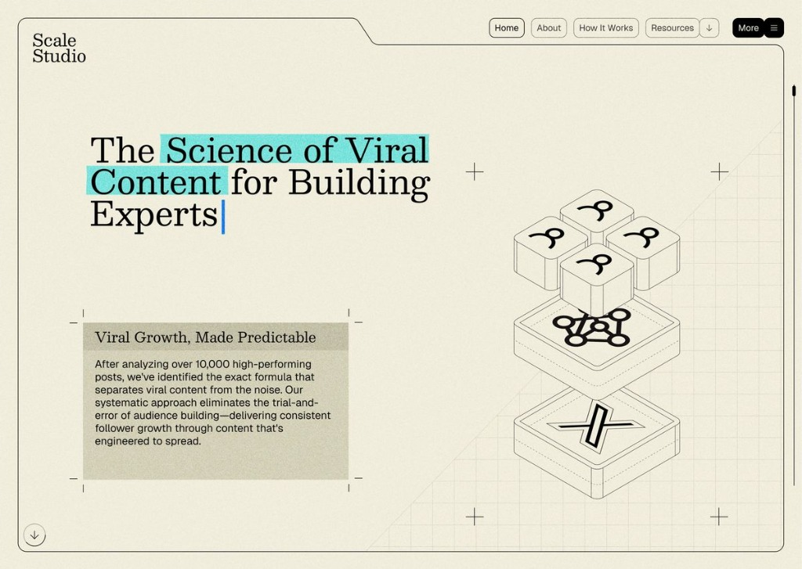
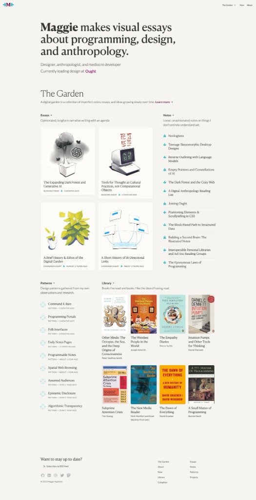
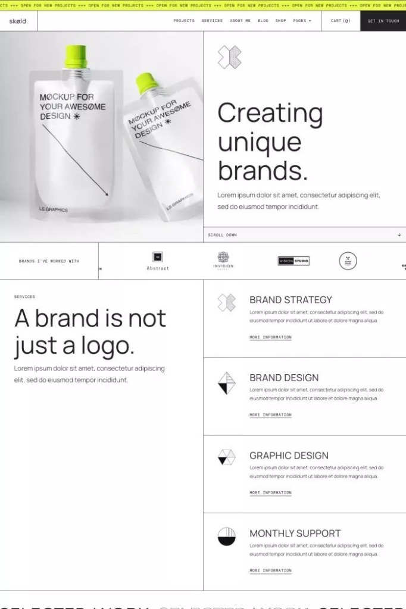

# Exploración de Estilos Visuales: Auditoría UX MotivarCare

> **Enfoque del Proyecto:** Sobrio, innovador, independiente de la marca, con tipografía serif contemporánea, dirigido a directivos y accionable para desarrollo/diseño.

---

## Índice de Exploración
* **Ronda 1:** Comparativa inicial a partir de las 3 referencias (Scale Studio, Maggie Appleton, skøld.).
* **Ronda 2:** Tres variaciones avanzadas a partir de la **Propuesta 1 (Dossier Técnico)** (Dark Forense, Archivo Salvia, Ledger Negocio).
* **Ronda 3 (Enfoque Salvia Seleccionado):** Tres variaciones avanzadas sobre la **Base Salvia**, incorporando **escala monumental en el Hero**, **textos regulares 100% Serif** y **3 colores de acento diferenciados** (Terracota, Lapislázuli, Ámbar).
* **Prototipo Interactivo en Vivo:** [`estilos_mockups.html`](./estilos_mockups.html) (con los 9 mockups funcionales).

---

## Ronda 1: Comparativa de Conceptos Iniciales

| Dimensión | Mockup 1: Expediente Técnico (Scale) | Mockup 2: Cuaderno de Investigación (Garden) | Mockup 3: Matriz de Precisión Suiza (Skøld) |
| :--- | :--- | :--- | :--- |
| **Referencia** | *Scale Studio* | *Maggie Appleton (Digital Garden)* | *skøld.* |
| **Metáfora visual** | Expediente pericial / Dossier de análisis | Ensayo visual humanista / Biblioteca | Grilla arquitectónica modular / Bento Grid |
| **Tipografía Serif** | **Instrument Serif** | **Newsreader** | **Playfair Display** |
| **Tipografía Apoyo** | **Space Mono** | **Inter** / Plus Jakarta Sans | **Inter** |
| **Fondo & Atmósfera** | Papel marfil cálido (`#EBE7DF`) con retícula | Blanco roto / Canvas suave (`#FBFBF9`) | Blanco puro (`#FFFFFF`) con bordes negros |
| **Acento de color** | Resaltador cian brillante (`#8EE0D9`) | Tinta grafito oscuro (`#1C1917`) | Ticker superior lima técnico (`#DDFF55`) |
| **Impacto** | Peritaje riguroso, analítico y científico | Reflexión, empatía y sensibilidad clínica | Control quirúrgico, estructura y modernidad |

### Visualización de Referencias Ronda 1
* **Scale Studio (Mockup 1):**  
  
* **Maggie Appleton (Mockup 2):**  
  
* **skøld. (Mockup 3):**  
  

---

## Ronda 2: Tres Variaciones Avanzadas sobre la Propuesta 1 (Dossier)

| Atributo | Mockup 4: Dark Forense | Mockup 5: Archivo Salvia V1 | Mockup 6: Ledger Negocio |
| :--- | :--- | :--- | :--- |
| **Inspiración** | Expediente forense confidencial / Ciberseguridad | Cuaderno de boticaria y laboratorio clínico | Libros de contabilidad y balances de gobierno |
| **Tipografía Serif** | **Instrument Serif Italic** (escala monumental) | **Cormorant Garamond** (elegancia tradicional) | **Playfair Display 900** (peso rotundo) |
| **Tipografía Secundaria** | **Space Mono** (terminal fósforo) | **Space Mono** + Newsreader | **Space Mono** (numérica tabular) + Inter |
| **Paleta Cromática** | Base carbón obsidiana (`#141413`), fósforo menta (`#4EF2D2`) | Papel salvia suave (`#E7ECE5`), tinta bosque (`#162921`) | Papel marfil hueso (`#F5F3ED`), azul ultramar (`#1E3A8A`) |

---

## Ronda 3: Evolución de la Base Salvia (Escala Monumental + 100% Serif de Lectura)

A partir de la selección de la **Base Salvia (Opción 5)** por su atmósfera equilibrada, aireada y sobria, se establecieron dos directrices tipográficas y de composición:

1. **Regla de lectura 100% Serif:** Todos los textos regulares (párrafos explicativos, dictamen ejecutivo, análisis de hallazgos) se maquetan en tipografía con serif para brindar máxima calidez literaria y reposo visual. Las fuentes sans-serif y mono se reservan **exclusivamente** para títulos de etiquetas marginales, chips, metadatos y notas técnicas.
2. **Tensión dramática de escala:** El titular principal (Hero H1) se eleva a escala monumental (hasta `8xl` / `5.5rem` con interlineado ultra compacto `leading-[0.88]`), contrastando fuertemente con la sutileza de la lectura.
3. **Exploración de 3 colores de acento diferenciados:** Terracota Óxido, Azul Lapislázuli Profundo y Ámbar Dorado.

```
                              BASE SALVIA (OPCIÓN 5)
                      "Papel Salvia + Tinta Bosque + Marginalia"
                                      │
            ┌─────────────────────────┼─────────────────────────┐
            ▼                         ▼                         ▼
        MOCKUP 7                  MOCKUP 8                  MOCKUP 9
   "Salvia & Terracota"      "Salvia & Lapislázuli"        "Salvia & Ámbar"
  (Instrument Serif 8xl,     (Playfair Black 900,        (Cormorant Display 8xl,
   Newsreader en lectura,     Cormorant en lectura,       Newsreader en lectura,
   Acento Terracota Óxido)    Acento Lapislázuli Notarial) Acento Ámbar Dorado)
```

### Tabla Comparativa de la Ronda 3

| Dimensión | Mockup 7: Salvia & Terracota Óxido | Mockup 8: Salvia & Azul Lapislázuli | Mockup 9: Salvia & Ámbar Dorado |
| :--- | :--- | :--- | :--- |
| **Titular Hero (Nivel 1)** | **Instrument Serif Italic & Regular** (`text-8xl`, curvas afiladas y esbeltas) | **Playfair Display Black (900)** (`text-7xl`, trazos gruesos rotundos y autoridad) | **Cormorant Garamond Display** (`text-8xl`, proporciones renacentistas áureas) |
| **Texto de Lectura Regular** | **Newsreader** (diseño óptico contemporáneo, calidez y ritmo) | **Cormorant Garamond** (clásica, refinada, muy fluida) | **Newsreader** (envolvente, pausada y académica) |
| **Etiquetas / Chips / Metadatos** | **Plus Jakarta Sans** (mayúsculas, tracking amplio `tracking-widest`) | **Inter** (micro-sans ultra limpia, peso bold) | **Space Mono** (precisión técnica de laboratorio pericial) |
| **Fondo Base** | Papel Salvia Sereno (`#E8ECE6`) con retícula milimétrica tenue | Papel Salvia Claro (`#E9EDE7`) con retícula milimétrica tenue | Papel Salvia Botánico (`#E7ECE5`) con retícula milimétrica tenue |
| **Tinta Principal** | Bosque Profundo / Carbón Vegetal (`#112017`) | Bosque Oscuro / Grafito Frío (`#12221A`) | Bosque Negro / Musgo Carbón (`#13231B`) |
| **Color de Acento** | **Terracota Óxido / Siena Tostada (`#C2593F`)** | **Azul Lapislázuli Profundo (`#1E3A8A`)** | **Ámbar Dorado / Ocre Solar (`#D99B26`)** |
| **Personalidad Visual** | Orgánica, terrosa, sofisticada y de alta tensión estética | Institucional, pericial, notarial y de gran contundencia | Tratado histórico iluminado, sereno y reflexivo |

---

### Detalle de las 3 Opciones de la Ronda 3

#### Mockup 7: "Salvia & Terracota Óxido" (Instrument Serif + Newsreader)
* **Titular Hero:** *Instrument Serif* a escala colosal (`text-8xl`), combinando palabras en redonda con énfasis en cursiva esbelta subrayada en terracota.
* **Cuerpo de texto:** *Newsreader* en cuerpo 18px con interlineado holgado, ofreciendo una lectura inmersiva tipo ensayo de diseño.
* **Acento cromático:** El **Terracota Óxido (`#C2593F`)** aporta calidez botánica sin estridencias, destacando el dictamen directivo, los sellos de severidad crítica y los números de impacto.
* **Micro-etiquetas:** *Plus Jakarta Sans* en mayúsculas con espaciado entre letras (*letter-spacing* amplio) para un look limpio y contemporáneo.

#### Mockup 8: "Salvia & Azul Lapislázuli Profundo" (Playfair Black 900 + Cormorant)
* **Titular Hero:** *Playfair Display* con su peso más contundente (Black 900), generando un contraste de trazo casi escultórico que denota solidez y control.
* **Cuerpo de texto:** *Cormorant Garamond* aporta una textura clásica y culta al diagnóstico.
* **Acento cromático:** El **Azul Lapislázuli (`#1E3A8A`)** evoca los sellos de tinta azul y las rúbricas notariales en dictámenes periciales oficiales.
* **Micro-etiquetas:** *Inter* en escala 10px bold para chips y barras de telemetría de salud UX.

#### Mockup 9: "Salvia & Ámbar Dorado" (Cormorant Display + Newsreader)
* **Titular Hero:** *Cormorant Garamond Display* llevado a escala monumental, luciendo sus serifs puntiagudas y proporciones clásicas con ligaduras elegantes.
* **Cuerpo de texto:** *Newsreader* para párrafos largos, garantizando legibilidad óptima.
* **Acento cromático:** El **Ámbar Dorado / Ocre (`#D99B26`)** funciona como un iluminador solar sutil sobre el fondo salvia, señalando hallazgos clave con la apariencia de papel pergamino refinado.
* **Micro-etiquetas:** *Space Mono* para códigos de folio (`FOLIO N° 09`), notas de auditoría y fechas.

---

## Cómo Explorar los 9 Mockups en Vivo
El visor interactivo local [`estilos_mockups.html`](./estilos_mockups.html) permite alternar al instante entre las 9 propuestas:
* **Fila superior (Ronda 3 - Destacada):** Botones 7 (Terracota), 8 (Lapislázuli) y 9 (Ámbar).
* **Botones 4, 5, 6:** Ronda 2 (Dark Forense, Salvia V1, Ledger).
* **Botones 1, 2, 3:** Ronda 1 (Scale Studio, Maggie Appleton, skøld.).
